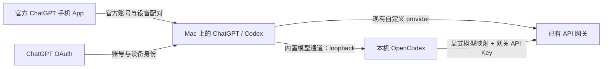

# Codex 混合登录与官方手机远程工作流

**用官方 ChatGPT 账号登录电脑端、用官方手机 App 连接这台电脑，模型推理继续使用自己的 API 中转。**

这个仓库把一次实际配置过程整理成可执行脚本和中文操作流程。它复用已经安装的 OpenCodex，不修改 ChatGPT/Codex 程序二进制，也不实现另一个手机远控客户端。



当前自动化针对**一个已配置的模型**建立路由，保留原来的模型名、推理强度和自定义 provider。切换到其他模型前，需要为它单独配置、验证路由。

## 已验证的范围

2026-10-09 的现场环境：

| 项目 | 结果 |
| --- | --- |
| macOS ChatGPT 桌面版 | `26.1002.52244` |
| 内置 Codex CLI | `0.162.0-alpha.2` |
| OpenCodex | `2.42.0` |
| 官方账号 | 免费账号，成功完成 OAuth；用户确认手机可看到电脑并发送任务 |
| 模型 | GPT-6 Astra；日常配置保留 `xhigh` |
| 自定义 provider 请求 | 官方 OAuth 存在时仍使用 provider 的 API 凭据；最小请求成功 |
| 内置 provider 请求 | OpenCodex 单目标映射，实际 API provider 返回 HTTP 200 |
| 原生 Computer Use | 成功操作 Chrome，完成点击、输入、提交 |
| 浏览器扩展工具 | 曾出现 `unsupported Codex auth method: apikey`；重开后旧工具会话仍报错，未将其标记为已修复 |

手机端连接由用户实测确认；本仓库记录的路由证据来自电脑端 CLI 请求。**手机发起的同一条任务与中转账单的逐条关联仍需按下面的验收步骤完成。**免费账号的实际入口和开放范围以官方账号界面为准，这次成功不代表所有账号、版本或地区均已开放。

## 使用前准备

- macOS，Python **3.11+**，Chrome，官方 ChatGPT/Codex 桌面 App。
- 一个已经可用的自定义 Responses API provider，位于 `~/.codex/config.toml`。
- 已安装且运行正常的 [OpenCodex](https://github.com/lidge-jun/opencodex)。本脚本使用 **2.42.0 的管理 API**；未来版本需要重新验证兼容性。
- OpenCodex 中已有一个 **key 模式**的 provider，API 地址和密钥与 Codex 现有 provider 一致。不要使用 `authMode: forward` 作为中转密钥通道。
- 手机与电脑使用同一个官方 ChatGPT 账号及工作区。

脚本不会替你安装 OpenCodex、创建 API 账号、充值或购买短信号码。官方网页要求的密码、验证码、通行密钥等，由用户在官方界面完成。

## 最短执行流程

```bash
git clone https://github.com/h3082445617-design/codex-hybrid-remote-workflow.git
cd codex-hybrid-remote-workflow
python3 scripts/hybrid_remote.py doctor
```

### 1. 在隔离目录完成官方登录

```bash
python3 scripts/hybrid_remote.py login --chrome-profile Default
```

浏览器会打开官方授权页。完成登录后，OAuth 保存到 `~/.local/state/codex-hybrid-remote/login-home/auth.json`，此时**尚未替换正在使用的 API 登录**。

`Default` 是 Chrome 的 profile 目录名，不一定是界面上的名字。需要其他 profile 时先在 `chrome://version` 查看 Profile Path，再传入对应的 `Profile 1` 等目录名。不要根据第一个窗口猜账号。

### 2. 查看计划并应用

```bash
python3 scripts/hybrid_remote.py plan
python3 scripts/hybrid_remote.py apply
```

如果存在多个匹配的 OpenCodex provider，显式选择：

```bash
python3 scripts/hybrid_remote.py --route-provider my-gateway plan
python3 scripts/hybrid_remote.py --route-provider my-gateway apply
```

所有全局选项都放在子命令前。已有配置使用不同 combo 名称时，传入 `--combo-id EXISTING_ID`。

`apply` 会：

1. 确认 OpenCodex readiness、网关地址与密钥匹配、现有模型及配置符合兼容条件。
2. 在仓库外创建权限为 `0700` 的备份目录，文件权限为 `0600`。
3. 使用 OpenCodex 支持的 `nativeAlias` 单目标 combo，把**当前模型**明确指向 key 模式的中转 provider。
4. 关闭 OpenCodex 的桌面免登录模式。
5. 保留自定义 provider，将原 API Key 放入该 provider 的 `experimental_bearer_token`，增加指向本机 OpenCodex 的 `openai_base_url`。
6. 将已完成的官方 OAuth 应用到主 `auth.json`。

脚本会比较修改前后的 TOML 语义，确认模型、推理强度及其他配置未改变。重复运行已完成的相同配置会返回 `already_configured`。发生冲突时停止，不覆盖未知配置。

### 3. 验证两条模型请求路径

```bash
python3 scripts/hybrid_remote.py verify
```

此命令会发出**两条小额计费请求**：自定义 provider 直连和内置 provider 经 OpenCodex。测试使用隔离的最小配置与低推理强度，不启动用户配置中的 MCP、通知或 hooks，也不修改日常的 `xhigh` 设置。它验证成功回复；要核对实际计费目标，还需在 OpenCodex Usage 中确认目标 provider 和 HTTP 状态。

### 4. 重开桌面应用

```bash
python3 scripts/hybrid_remote.py restart
```

脚本会在 5 秒后正常退出并重新打开 ChatGPT，不强制杀进程。即使当前终端来自 ChatGPT，独立启动的重开进程也能继续运行。状态文件是：

```text
~/.local/state/codex-hybrid-remote/restart-status.json
```

如果安装的是 `Codex.app`：

```bash
python3 scripts/hybrid_remote.py restart --app Codex
```

进程重开不等于所有旧工具会话都刷新成功；仍需分别验证原生 Computer Use 和浏览器扩展工具。

### 5. 用官方手机 App 配对和验收

1. 电脑端打开 **设置 → 连接 → 控制此 Mac → 设置／添加**。
2. 用手机扫描电脑屏幕上的配对二维码；不要把二维码或配对链接发到仓库、聊天或日志。
3. 手机 ChatGPT 打开 **Codex**；旧版可能显示 **Remote**。确认同一账号和工作区。
4. 进入这台 Mac，选择已配置的模型，发送：

   > 在这台 Mac 上运行 `sw_vers -productVersion`，然后只回复系统版本。

5. 确认命令在这台 Mac 执行，并在中转用量记录核对同一时间的请求。需要测试 Computer Use 时，再发送一个简单的 Chrome 操作任务。

电脑需要保持联网、桌面 App 运行，并保持唤醒。使用官方连接设置中的保持唤醒选项即可；本脚本不会修改系统电源设置或开放公网端口。

## 回滚

`apply` 输出的 `backup` 路径就是本次恢复点：

```bash
python3 scripts/hybrid_remote.py rollback --backup "$HOME/.local/state/codex-hybrid-remote/backup-YYYYMMDD-HHMMSS-ffffff"
python3 scripts/hybrid_remote.py restart
```

回滚只恢复本次管理的两个 Codex 文件、combo 和免登录开关，保留 OpenCodex 的其他设置。如果文件随后被用户修改，或者 OAuth 自动刷新使文件发生变化，脚本会停止，要求人工比较私密备份，避免覆盖新状态。不要用旧 `auth.json` 盲目覆盖后来刷新的令牌。

如果 `apply` 中途失败，也会留下阶段记录和备份。先检查输出的备份路径，再运行回滚；不要不断重复应用。

## 故障定位

| 现象 | 判断与处理 |
| --- | --- |
| `unsupported Codex auth method: apikey` | 先确认主 `auth.json` 是真实 OAuth，再确认桌面 App 及工具认证子进程是否仍缓存 API 状态。JS reset 不保证重启认证子进程。不要伪造 OAuth 或修改二进制认证检查。 |
| 浏览器扩展工具失败，但原生 Computer Use 能操作 Chrome | 两条控制路径不同。工具可用时分别测试 `cua.getBrowser(...)` 和 `cua.getApp("Google Chrome")`；不要把扩展认证错误判断成整个 Computer Use 不可用。 |
| 工具禁止控制 ChatGPT 自身 | 在允许的界面由用户完成设置。已获用户授权时可以使用本仓库的系统重开命令；不要绕过工具的应用访问限制。 |
| 仅设置 `defaultProvider` 后仍走官方通道 | 裸 `gpt-*` 名可能优先匹配内置通道。本工作流使用显式 `nativeAlias` combo；新增模型也要独立配置与验证。 |
| OpenCodex 返回 HTTP 400 | 先检查版本和 combo 支持范围。不要直接改内置 `openai` provider；它的配置受到官方种子形状约束。 |
| 修改 OpenCodex JSON 后行为没变 | 运行中的服务可能没加载磁盘修改。本脚本使用管理 API 更新内存和磁盘配置。 |
| 登录网页返回 HTML / `Unexpected token '<'` | 先确认官方登录站点网络可达，以及浏览器使用的网络路径；不要立刻归因于账号资格或手机号。 |
| 免费账号界面没有远程入口 | 以实际账号的官方入口和当前发布范围为准。脚本不能创造账号侧未开放的能力。 |

有关一次性短信服务的经验：平台的“50%”可能是**具体供应线路**的历史接码率；随机分配的线路未必相同。显示库存也不等于取号接口一定有号。若官方提示只允许 WhatsApp，继续轮询短信不会解决该号码的通道限制。这些步骤不包含在本仓库自动化中。

## 仓库内容与隐私边界

- [scripts/hybrid_remote.py](scripts/hybrid_remote.py)：标准库实现的命令行工具。
- [docs/AGENT_WORKFLOW.md](docs/AGENT_WORKFLOW.md)：可直接交给 Codex 执行的工作流。
- [docs/VALIDATION.md](docs/VALIDATION.md)：实际验证记录与尚未验证的范围。
- [tests/test_workflow.py](tests/test_workflow.py)：本地单元测试；不访问真实账号。
- [.github/workflows/ci.yml](.github/workflows/ci.yml)：GitHub Actions 测试。

仓库不会保存账号信息或运行备份。私密文件只留在执行者本机。不要上传 `auth.json`、真实 `config.toml`、管理令牌、运行日志或 `.local/state` 内容。

## 官方与项目参考

- [官方认证说明](https://learn.chatgpt.com/docs/auth)
- [官方手机远程连接](https://learn.chatgpt.com/docs/remote-connections)
- [官方配置参考](https://learn.chatgpt.com/docs/config-file/config-reference)
- [官方 App Server 协议](https://learn.chatgpt.com/docs/app-server)
- [OpenCodex 项目](https://github.com/lidge-jun/opencodex)
- [CodexPlusPlus 项目](https://github.com/BigPizzaV3/CodexPlusPlus)：另一种实现思路；本工作流无需另行安装。

本仓库是社区工作流，与 OpenAI 及上述项目没有官方关联。版本兼容性以实测和本地检查结果为准。
